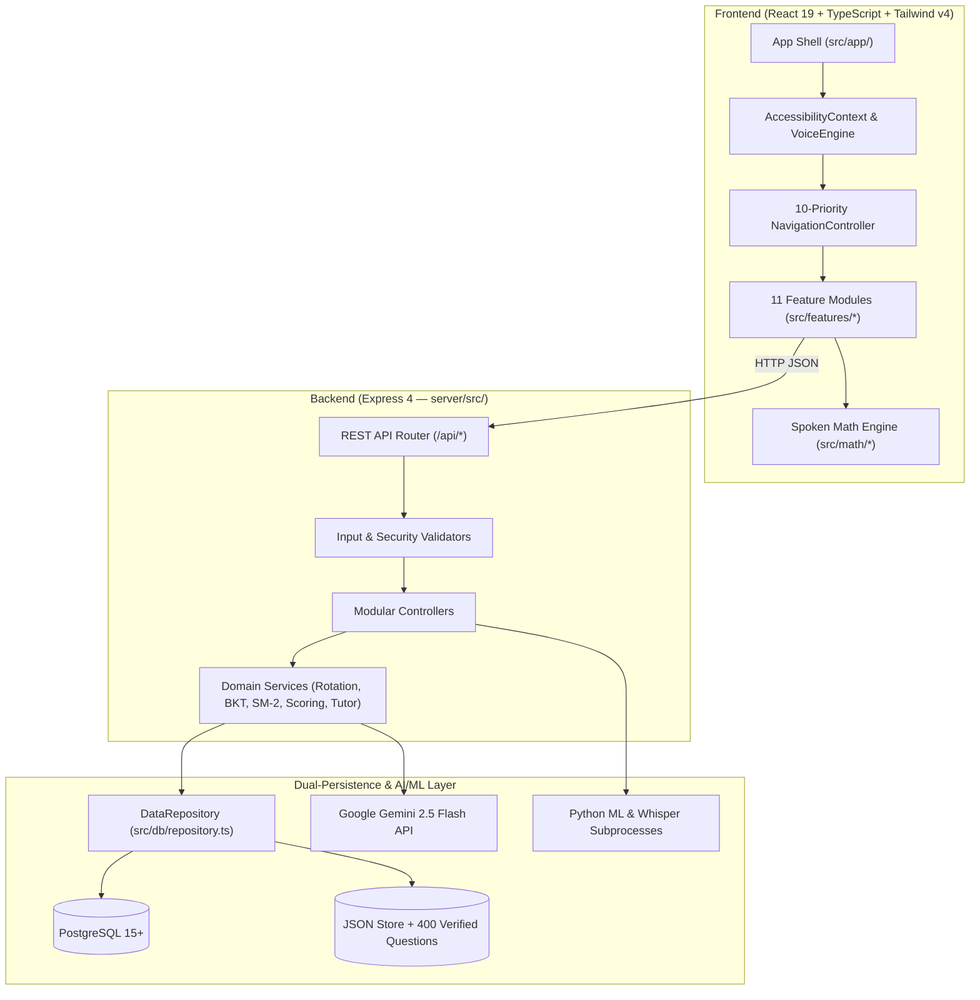

# ACCESSPREP-X — Architecture Overview

## 1. Architectural Vision

**ACCESSPREP-X** is an audio-first, AI-assisted competitive examination preparation platform engineered specifically for blind, low-vision, and Persons with Disabilities (PwD) candidates preparing for the **Staff Selection Commission Multi-Tasking Staff (SSC MTS)** examination.

The system is architected around four non-negotiable pillars:
1. **Zero-Visual-Dependency Operation**: Every workflow—onboarding, login/registration with Audio CAPTCHA, subject selection, voice practice, 100-question mock exam, 20-question pilot diagnostic, live transcript workspace, AI tutoring, and SM-2 revision—is 100% operable via spoken voice commands (`"Hey Vision"`), Text-to-Speech (TTS), and keyboard shortcuts.
2. **Feature-Oriented Modularity**: Domain logic is cleanly separated into `src/features/*` (frontend) and `server/src/{controllers,services,repositories,validators,routes,middleware}` (backend).
3. **Resilient Dual-Persistence Data Layer**: All candidate records, attempts, BKT mastery states, SM-2 schedules, and speech transcripts persist transactionally to **PostgreSQL** when available and automatically fall back to an atomic **JSON File Store** (`src/data/app_database.json`) without downtime.
4. **Deterministic Pedagogical & Speech Fallbacks**: Both the AI Tutor (Gemini 2.5 Flash) and Speech Recognition (Browser Web Speech API + OpenAI Whisper) include deterministic syllabus-grounded fallbacks so candidates are never blocked by network or API outages.

---

## 2. High-Level System Architecture

---

## 3. Core Subsystems

### 3.1 10-Priority Voice Navigation Controller (`src/voice/NavigationController.ts`)
Incoming speech transcripts are processed deterministically through a 10-level priority chain:
1. **Wake-Word Gating**: `"Hey Vision"` activation and deactivation.
2. **Speech Setting Commands**: Real-time speech rate (`faster`, `slower`) and pitch adjustments.
3. **Active-Exam Exit Confirmation**: `"Yes"` / `"No"` confirmation when attempting to leave an active exam.
4. **Screen-Specific Voice Handler**: Delegated to the active screen (e.g., answering `"Option A"`, `"Mark for review"`, `"Repeat question"`, or dictating math steps).
5. **System Speech Controls**: `"Stop"`, `"Repeat"`, `"Pause"`, `"Resume"`.
6. **Active-Exam Safety Guard**: Intercepts accidental navigation away from a live exam.
7. **Global & Page-Specific Assistance**: `"Where am I"`, `"What can I do here"`, `"Help"`.
8. **Global Screen Routing**: Matches natural phrases to the 18 approved screens in `SCREEN_REGISTRY`.
9. **Logout Intent**: Safe session termination outside active exams.
10. **Unrecognized Command Guidance**: Polite spoken guidance when a phrase does not match an intent.

### 3.2 Non-Repeating Mock Exam Rotation (`src/services/mockExamRotationService.ts`)
- Guarantees that a candidate never sees a repeated question across consecutive Mock Examination attempts within the same 400-question cycle.
- Tracks per-user `MockExamRotationState` and `MockExamQuestionAssignment` records independently from Voice Practice.
- Supports seamless session resume (preserving remaining time, current question index, and marked-for-review states) and explicit cycle reset once all 400 questions are exhausted.

### 3.3 Adaptive Mastery & Spaced Repetition (`src/utils/bkt.ts` & `src/utils/sm2.ts`)
- **Bayesian Knowledge Tracing (BKT)**: Updates `p_known` after every practice and diagnostic response using $P(L_0)=0.25$, $P(T)=0.15$, $P(S)=0.10$, and $P(G)=0.25$, classifying topics into `Novice`, `Developing`, `Proficient`, or `Mastered`.
- **SuperMemo SM-2**: Computes optimal review intervals (`intervalDays`, `easinessFactor`, `repetitions`) based on response accuracy and speed.
