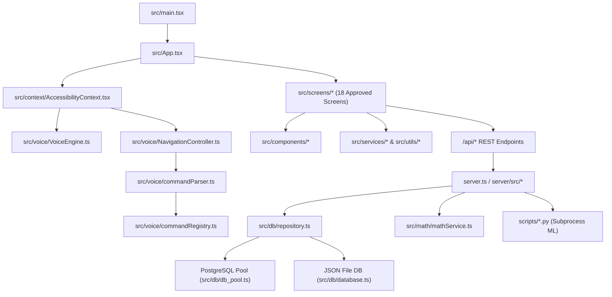

# ACCESSPREP-X — Complete Project Audit Report

**Audit Date:** November 2026  
**Project:** ACCESSPREP-X (Audio-First AI Examination Preparation Platform for Blind & Visually Challenged SSC MTS Aspirants)  
**Target Stack:** React 19 + TypeScript 5.8 + Tailwind CSS v4 + Vite 6 (Frontend) | Node.js + Express 4 + Dual-Persistence Repository (`pg` PostgreSQL + JSON File Store) + Python ML Pipeline (Backend)

---

## 1. Existing Folder Structure

Prior to refactoring, the repository layout was structured as follows:

```text
Vision-main-2/
├── index.html
├── metadata.json
├── package.json
├── package-lock.json
├── README.md
├── server.ts                          # Monolithic 1,693-line Express backend + Vite middleware
├── tsconfig.json
├── vite.config.ts
├── docs/
│   ├── ACCESSIBILITY_CONFORMANCE.md
│   ├── AI_ASSISTANCE_POLICY.md
│   ├── ARCHITECTURE.md
│   ├── DATABASE_SETUP.md
│   ├── DATA_DICTIONARY.md
│   ├── ETHICS_PRIVACY.md
│   ├── EVALUATION_REPORT.md
│   ├── MODEL_JUSTIFICATION.md
│   ├── PILOT_TESTING_PLAN.md
│   ├── TESTING_REPORT.md
│   └── VIVA_QA.md
├── public/
│   └── assets/
│       └── aistudio/
│           ├── Vision-main-2.zip
│           └── stitch_remix_of_stitch_accessibility_onboarding_setup.zip
├── scripts/
│   ├── build_ssc_mts_dataset.py
│   ├── evaluate_model.py
│   ├── generate_dataset.py
│   ├── generate_math_test_dataset.py
│   ├── generate_questions.py
│   ├── predict_mastery.py
│   ├── train_model.py
│   └── validate_dataset.py
├── stitch_design/                     # Static UI design prototypes (HTML + PNG screenshots)
│   └── ... (16 prototype directories)
└── src/
    ├── App.tsx
    ├── index.css
    ├── main.tsx
    ├── components/
    │   ├── AccessibleFormField.tsx
    │   ├── AccessibleProgressBar.tsx
    │   ├── AudioToolbar.tsx
    │   ├── EmptyState.tsx
    │   ├── ErrorBoundary.tsx
    │   ├── Header.tsx
    │   ├── LoadingSkeleton.tsx
    │   ├── Navigation.tsx
    │   ├── PageEntryHelpBanner.tsx
    │   ├── ScreenNavigationDisclaimer.tsx
    │   └── auth/
    │       ├── AudioCaptchaControls.tsx
    │       ├── AuthenticationErrorMessage.tsx
    │       ├── VoiceGuidanceControls.tsx
    │       └── VoiceInputButton.tsx
    ├── context/
    │   └── AccessibilityContext.tsx
    ├── data/
    │   ├── app_database.json
    │   ├── data_dictionary.json
    │   ├── dataset_validation_report.json
    │   ├── math_speech_test_dataset.json
    │   ├── model_artifact.pkl
    │   ├── model_evaluation_report.json
    │   ├── pageHelpRegistry.ts
    │   └── ssc_mts_questions.json     # 400 verified SSC MTS questions across 4 subjects
    ├── db/
    │   ├── database.ts
    │   ├── db_pool.ts
    │   ├── migration.ts
    │   ├── repository.ts
    │   ├── schema.sql
    │   └── seed_postgres.ts
    ├── math/
    │   ├── mathAnswerSession.ts
    │   ├── mathService.ts
    │   ├── mathematicalAnswerEvaluator.ts
    │   ├── mathematicalExpressionNormalizer.ts
    │   ├── mathematicalSpeechParser.ts
    │   ├── mathematicalSpeechRenderer.ts
    │   ├── math_evaluation_results.json
    │   └── spokenMathVocabulary.ts
    ├── screens/                       # 18 approved screens in a flat folder
    │   ├── AccessibilitySettingsScreen.tsx
    │   ├── AiTutorScreen.tsx
    │   ├── DashboardScreen.tsx
    │   ├── LearningHistoryScreen.tsx  # 1,449 lines
    │   ├── LoginScreen.tsx
    │   ├── MockExamScreen.tsx         # 1,496 lines
    │   ├── ModelEvaluationScreen.tsx
    │   ├── ModelTrainingScreen.tsx
    │   ├── PilotDemoScreen.tsx        # 2,898 lines
    │   ├── ProgressScreen.tsx
    │   ├── RegisterScreen.tsx
    │   ├── ResultsScreen.tsx
    │   ├── RevisionPlannerScreen.tsx  # 1,105 lines
    │   ├── ScreenReaderSettingsScreen.tsx
    │   ├── TopicMasteryScreen.tsx
    │   ├── TopicsScreen.tsx
    │   ├── VoicePracticeScreen.tsx    # 1,609 lines
    │   └── WelcomeScreen.tsx
    ├── services/
    │   └── mockExamRotationService.ts
    ├── tests/                         # 21 test suites (236 test cases)
    │   └── *.test.ts
    ├── types/
    │   └── screens.ts
    ├── utils/
    │   ├── answerParser.ts
    │   ├── audioBeacon.ts
    │   ├── authVoiceUtils.ts
    │   ├── bkt.ts
    │   ├── currentAffairsService.ts
    │   ├── grammarChecker.ts
    │   ├── humanVerification.ts
    │   ├── pilotDemoAcceptance.ts
    │   ├── pilotDemoScoring.ts
    │   ├── repeatQuestionHelper.ts
    │   ├── scoring.ts
    │   └── sm2.ts
    └── voice/
        ├── NavigationController.ts
        ├── VoiceEngine.ts
        ├── commandParser.ts
        ├── commandRegistry.ts
        └── commandTypes.ts
```

---

## 2. Existing Architecture

1. **Single-Process Full-Stack Runtime (`server.ts`)**:
   - An Express 4 server handles all `/api/*` REST endpoints on port `3000`.
   - In development (`NODE_ENV !== 'production'`), Vite middleware is mounted directly inside the Express server for HMR and SPA rendering.
   - In production (`NODE_ENV === 'production'`), Express serves static assets from `dist/`.
2. **State-Driven 18-Screen Router (`src/App.tsx` + `src/types/screens.ts`)**:
   - Navigation is managed through `currentScreen: ScreenId` in `App.tsx`, validated against `APPROVED_SCREENS` (18 screens).
   - Every screen transition triggers spoken orientation, focus management (`#main-content`), and optional audio beacons.
3. **Global Accessibility & Voice Architecture (`src/context/AccessibilityContext.tsx` + `src/voice/*`)**:
   - `AccessibilityContext` provides unified TTS (`window.speechSynthesis`), STT (`VoiceEngine` wrapping Web Speech API + MediaRecorder server fallback), Vision Mode (`VisionModeOverlay` + black-out curtain), high-contrast/dark themes, font scaling, and user authentication state.
   - `NavigationController` dispatches parsed voice intents (`commandParser.ts`, `commandRegistry.ts`) across global navigation, question answering, math multi-step solving, transcript workspace commands, and form dictation.
4. **Dual-Persistence Data Layer (`src/db/repository.ts` + `src/db/database.ts`)**:
   - Automatically selects PostgreSQL (`pg` pool via `src/db/db_pool.ts`) when `DATABASE_URL` or `PGHOST` is reachable, and seamlessly falls back to a local atomic JSON store (`src/data/app_database.json`) seeded from `src/data/ssc_mts_questions.json` (400 verified SSC MTS questions).

---

## 3. Major Modules

| Module | Current Locations | Core Responsibilities |
| :--- | :--- | :--- |
| **Authentication & Audio CAPTCHA** | `LoginScreen.tsx`, `RegisterScreen.tsx`, `src/components/auth/*`, `src/utils/humanVerification.ts`, `src/utils/authVoiceUtils.ts` | Spoken login/registration, field-by-field voice dictation, spoken digit Audio CAPTCHA with HMAC/SHA-256 verification, PBKDF2 password hashing. |
| **Mock Examination** | `MockExamScreen.tsx`, `src/services/mockExamRotationService.ts`, `src/utils/scoring.ts` | 100-question / 90-minute (120m scribe) full-length exam, non-repeating question rotation across attempts, section jumper, palette filters, negative marking scorecard. |
| **Voice Practice** | `VoicePracticeScreen.tsx`, `src/utils/answerParser.ts`, `src/utils/bkt.ts`, `src/utils/sm2.ts` | Subject-wise adaptive voice practice, Bayesian Knowledge Tracing (BKT) mastery updates, SM-2 spaced repetition scheduling, step-by-step math expression evaluation. |
| **Transcript Workspace** | `LearningHistoryScreen.tsx` | 4-tab workspace: Overview Audit Log, Live Voice Recognition Log, Live Dictation & Recording Workspace (Web Speech + MediaRecorder + export), and Transcript Privacy Settings. |
| **Accessibility & Voice System** | `AccessibilityContext.tsx`, `AccessibilitySettingsScreen.tsx`, `ScreenReaderSettingsScreen.tsx`, `src/voice/*`, `src/utils/audioBeacon.ts` | Wake-word `"Hey Vision"`, continuous/push-to-talk STT, browser TTS, Vision Mode screen-curtain, WCAG 2.1 AAA high-contrast styling, keyboard shortcuts. |
| **AI Tutor & Revision Planner** | `AiTutorScreen.tsx`, `RevisionPlannerScreen.tsx` | Gemini 2.5 Flash Socratic tutoring, audio-first study scheduling, voice-driven subject selection, daily target persistence. |
| **Progress, Mastery & Results** | `DashboardScreen.tsx`, `ProgressScreen.tsx`, `TopicMasteryScreen.tsx`, `TopicsScreen.tsx`, `ResultsScreen.tsx` | Accessible SVG/table BI charts, BKT topic mastery tracking, mock exam scorecards, detailed question review. |
| **Pilot Demo (25-Q Diagnostic)** | `PilotDemoScreen.tsx`, `src/utils/pilotDemoScoring.ts`, `src/utils/pilotDemoAcceptance.ts` | Self-contained 25-question balanced diagnostic exam (7 Reasoning, 6 Numerical, 6 English, 6 GA), deterministic 2-pass spoken command validator, wrong-answer review dialogue. |
| **Mathematical Voice Engine** | `src/math/*` | Spoken math vocabulary, expression normalizer, speech parser, speech renderer, step-by-step evaluator. |
| **ML Pipeline & Evaluation** | `ModelEvaluationScreen.tsx`, `ModelTrainingScreen.tsx`, `scripts/*.py` | Random Forest / Gradient Boosting mastery classifier training, evaluation metrics, dataset validation. |

---

## 4. Dependency Relationships



---

## 5. Identified Architectural & Code Quality Problems

1. **Pre-Existing TypeScript Compilation Errors (17 Errors in `npm run lint`)**:
   - **9 Screen Files (`AccessibilitySettingsScreen.tsx`, `AiTutorScreen.tsx`, `DashboardScreen.tsx`, `MockExamScreen.tsx`, `ProgressScreen.tsx`, `ResultsScreen.tsx`, `RevisionPlannerScreen.tsx`, `TopicMasteryScreen.tsx`, `TopicsScreen.tsx`, `VoicePracticeScreen.tsx`)**: Pass uppercase strings (e.g. `"DASHBOARD"`, `"MOCK_EXAM"`) to `<ScreenNavigationDisclaimer screenId="..." />`, which expects lowercase `ScreenId` (`"dashboard"`, `"mock_exam"`).
   - **`src/screens/MockExamScreen.tsx:173`**: Type mismatch on `setAnswers(attempt.answers || {})` due to optional `markedForReview?: boolean | undefined`.
   - **`src/tests/transcript_workspace_navigation.test.ts:6, 26, 74`**: Imports `User` from `AccessibilityContext.tsx` (which did not re-export `User`), and instantiates `NavigationController` without optional `stopSpeak` and `logout` callbacks.
   - **`src/voice/commandParser.ts:547`**: `SubjectSelectionResult` union type omits `'all'` despite returning `subject: 'all'` when the user says `"all subjects"`.
2. **Frontend / Backend Boundary Leak (`crypto` and `fs` in Browser Bundle)**:
   - `LoginScreen.tsx` and `RegisterScreen.tsx` import `extractDigits` from `src/utils/humanVerification.ts`, which has a top-level `import crypto from 'crypto'`. This causes Vite to emit a build warning: `Module "crypto" has been externalized for browser compatibility`.
   - Multiple frontend screens import domain types (`User`, `Question`, `MockExamAttempt`, etc.) directly from `src/db/database.ts` (which imports Node's `fs` and `path`).
3. **Monolithic Backend File (`server.ts` — 1,693 lines)**:
   - All 45+ API routes, request validations, business logic, password hashing, Gemini proxy helpers, Python subprocess runners, and inline HTML reports are packed into a single root `server.ts` file instead of modular `routes/`, `controllers/`, `services/`, `repositories/`, `validators/`, and `middleware/`.
4. **Oversized Frontend Screen Files**:
   - `PilotDemoScreen.tsx` (2,898 lines), `VoicePracticeScreen.tsx` (1,609 lines), `MockExamScreen.tsx` (1,496 lines), `LearningHistoryScreen.tsx` (1,449 lines), and `RevisionPlannerScreen.tsx` (1,105 lines) combine UI presentation, state management, audio/speech side effects, and domain helpers in single files.
5. **Flat Component & Screen Organisation**:
   - All 18 screens live in a flat `src/screens/` folder and shared components live in a flat `src/components/` folder rather than feature-oriented modules (`src/features/*`) and categorised UI component directories (`common/`, `ui/`, `forms/`, `feedback/`, `navigation/`, `accessibility/`).
6. **Missing `.env.example` & Documentation Structure**:
   - No `.env.example` exists at the project root to document environment variables (`PORT`, `GEMINI_API_KEY`, `DATABASE_URL`, `PG*`, `DISABLE_HMR`).
   - Documentation in `docs/` is flat rather than organised into `docs/architecture/`, `docs/modules/`, and `docs/setup/`.

---

## 6. Duplicate Files and Logic

1. **Password Hashing Duplication**:
   - PBKDF2 password hashing (`hashPassword` / `verifyPassword`) is implemented inline in `server.ts` and duplicated inside `src/tests/auth_api_workflow.test.ts`. Extracting this into `server/src/utils/password.utils.ts` provides a single canonical implementation.
2. **Repeated Domain Type Declarations**:
   - Domain interfaces (`Question`, `User`, `MockExamAttempt`, `TranscriptLogEntry`) are defined in `src/db/database.ts` and partially re-declared across screen files. Consolidating them into `src/types/global/domain.types.ts` (with re-exports in `src/db/database.ts`) eliminates duplication and prevents Node module leakage into the client bundle.
3. **Repeated Inline Sub-Views in Large Screens**:
   - Scorecards, instruction banners, and modal dialogs are defined inline inside `PilotDemoScreen.tsx`, `MockExamScreen.tsx`, `VoicePracticeScreen.tsx`, and `LearningHistoryScreen.tsx`.

---

## 7. Unused / Static Prototype Files Requiring Verification

| File / Directory | Classification | Verification Finding & Action |
| :--- | :--- | :--- |
| `src/utils/grammarChecker.ts` | Tested Utility | Imported by `src/tests/integration.test.ts` (Suite 4). **Must be preserved** (and re-exported from `src/lib/validators/`). |
| `src/math/mathAnswerSession.ts` | Tested Module | Imported by `src/tests/math_step_session.test.ts`. **Must be preserved**. |
| `stitch_design/*` | Static UI Prototypes | 16 folders of static HTML/PNG design mocks not imported by runtime code. Preserved as design archive and documented in `REFACTOR_CHANGELOG.md`. |
| `public/assets/aistudio/*.zip` | Legacy Zip Archives | Two archive bundles (`Vision-main-2.zip`, `stitch_remix_...zip`, ~5.7 MB) inside `public/assets/aistudio/` that get copied into `dist/` on every build. Documented in `REFACTOR_CHANGELOG.md`. |

---

## 8. Recommended Target Folder Structure

We adopt the feature-oriented modular architecture adapted to preserve 100% compatibility with Vite, `tsx server.ts`, Python scripts (`scripts/*.py`), and all 21 test suites (`src/tests/*.test.ts`):

```text
ACCESSPREP-X/
├── public/
│   └── assets/
├── src/
│   ├── app/
│   │   ├── App.tsx
│   │   ├── main.tsx
│   │   ├── routes/
│   │   ├── providers/
│   │   └── layouts/
│   ├── components/
│   │   ├── common/
│   │   ├── ui/
│   │   ├── forms/
│   │   ├── feedback/
│   │   ├── navigation/
│   │   └── accessibility/
│   ├── features/
│   │   ├── authentication/
│   │   ├── dashboard/
│   │   ├── mock-exam/
│   │   ├── voice-practice/
│   │   ├── transcript-workspace/
│   │   ├── accessibility/
│   │   ├── ai-tutor/
│   │   ├── revision-planner/
│   │   ├── progress/
│   │   ├── results/
│   │   └── pilot-demo/
│   ├── context/
│   │   ├── AccessibilityContext.tsx
│   │   └── index.ts
│   ├── hooks/
│   │   ├── useSpeech.ts
│   │   ├── useKeyboardNavigation.ts
│   │   └── index.ts
│   ├── services/
│   │   ├── api/
│   │   ├── speech/
│   │   ├── storage/
│   │   ├── audio/
│   │   └── index.ts
│   ├── lib/
│   │   ├── constants/
│   │   ├── helpers/
│   │   ├── validators/
│   │   └── utilities/
│   ├── types/
│   │   ├── global/
│   │   ├── api/
│   │   ├── screens.ts
│   │   └── index.ts
│   ├── styles/
│   │   ├── globals.css
│   │   ├── variables.css
│   │   ├── themes/
│   │   └── accessibility.css
│   ├── assets/
│   ├── data/                          # Preserved at src/data/* for runtime & Python script compatibility
│   ├── db/                            # Preserved & bridged with server/src/repositories/*
│   ├── math/                          # Spoken Mathematical Voice Engine
│   ├── voice/                         # VoiceEngine, NavigationController, commandParser/Registry
│   ├── screens/                       # Barrel re-exports to src/features/*/screens/* for test compatibility
│   └── tests/                         # 21+ automated test suites
├── server/
│   ├── src/
│   │   ├── config/
│   │   ├── routes/
│   │   ├── controllers/
│   │   ├── services/
│   │   ├── middleware/
│   │   ├── repositories/
│   │   ├── models/
│   │   ├── validators/
│   │   ├── utils/
│   │   ├── app.ts
│   │   └── server.ts
│   └── tests/
├── data/                              # Schema, question bank & seed references
│   ├── questions/
│   ├── seed/
│   └── schemas/
├── tests/                             # Categorised unit, integration, accessibility & e2e test entry points
│   ├── unit/
│   ├── integration/
│   ├── accessibility/
│   └── e2e/
├── docs/
│   ├── architecture/
│   ├── modules/
│   ├── api/
│   ├── database/
│   ├── accessibility/
│   ├── setup/
│   └── deployment/
├── scripts/
├── .env.example
├── package.json
├── server.ts                          # Entry point delegating to server/src/server.ts
├── tsconfig.json
├── vite.config.ts
└── README.md
```

---

## 9. Refactoring Strategy (Incremental & Zero-Regression)

1. **Step 1 — Git Baseline Checkpoint**: Initialize a local Git repository and commit the unmodified baseline state before moving or editing any source file.
2. **Step 2 — Shared Types, Styles & Browser-Safe Utilities**:
   - Extract shared domain interfaces into `src/types/global/domain.types.ts` and `src/types/api/api.types.ts` (re-exporting from `src/db/database.ts`).
   - Refactor `src/utils/humanVerification.ts` to use cross-platform Web Crypto (`globalThis.crypto.getRandomValues`) instead of Node's `crypto` module so Vite builds without externalization warnings.
   - Organise `src/styles/` (`globals.css`, `variables.css`, `accessibility.css`, `themes/themes.css`) and `src/lib/` (`constants/`, `helpers/`, `validators/`, `utilities/`).
3. **Step 3 — Categorised Shared Components & Feature Modules**:
   - Organise `src/components/{common,ui,forms,feedback,navigation,accessibility}` and `src/features/{authentication,dashboard,mock-exam,voice-practice,transcript-workspace,accessibility,ai-tutor,revision-planner,progress,results,pilot-demo}`.
   - Split oversized screens (`PilotDemoScreen.tsx`, `MockExamScreen.tsx`, `VoicePracticeScreen.tsx`, `LearningHistoryScreen.tsx`, `RevisionPlannerScreen.tsx`) into cohesive sub-components, hooks, and services within their feature directories while keeping backward-compatible re-exports in `src/screens/*` and `src/components/*`.
4. **Step 4 — Backend Modularisation (`server/src/*`)**:
   - Decompose `server.ts` into `server/src/{config,models,repositories,validators,services,controllers,routes,middleware,utils}` and `server/src/app.ts` + `server/src/server.ts`, with root `server.ts` cleanly bootstrapping the modular server.
5. **Step 5 — TypeScript Error Resolution & Full Verification**:
   - Fix all 17 TypeScript errors so `npm run lint` (`tsc --noEmit`) passes with 0 errors.
   - Verify `npm test` (all 236+ tests pass) and `npm run build` (`vite build` succeeds with zero warnings).
6. **Step 6 — Comprehensive Documentation**:
   - Generate all architecture, module, database, API, accessibility, and setup documentation under `docs/` and update `README.md`.

---

## 10. Potential Risks & Mitigation

| Risk | Impact | Mitigation Strategy |
| :--- | :--- | :--- |
| Breaking existing test imports (`src/tests/*.test.ts`) | High | Preserve barrel re-exports at original paths (`src/screens/*`, `src/components/*`, `src/utils/*`, `src/db/*`, `src/services/*`) while migrating implementations to `src/features/*`, `src/lib/*`, and `server/src/*`. |
| Breaking Python script or DB seed file paths | High | Keep `src/data/*.json` and `src/db/schema.sql` in place at their exact paths resolved via `process.cwd()`. |
| Regressing `APPROVED_SCREENS` (18-screen limit) | High | Do not alter the 18 screen IDs in `src/types/screens.ts`; run `screen_limit.test.ts` and `voice_navigation.test.ts` after every change. |
| Mixing Mock Exam rotation with Voice Practice rotation | High | Keep `mockExamRotationService.ts` and `/api/mock/*` strictly isolated from `/api/practice/*` and `VoicePracticeScreen`. |
| Breaking VoiceEngine or AccessibilityContext | Critical | Maintain a single `AccessibilityProvider` instance and preserve all wake-word, TTS, STT, Audio CAPTCHA, and Vision Mode contracts. |
